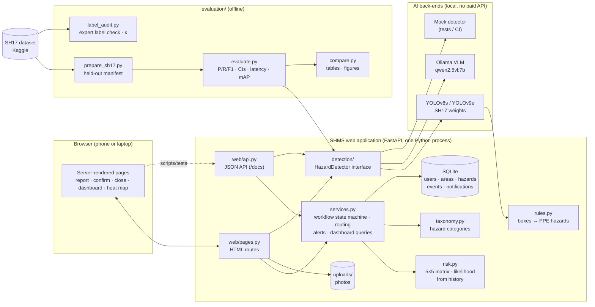

# Architecture

## Component responsibilities

| Component | Responsibility | Interface |
|---|---|---|
| `web/pages.py`, `templates/` | HTML pages; no business rules | HTTP form posts → service calls |
| `web/api.py` | JSON API for scripts and tests | `POST /api/hazards`, `/confirm`, `/close`, `GET /api/dashboard`, `POST /api/detect` |
| `services.py` | Workflow (DRAFT → OPEN → CLOSED), permissions, routing to Area Owner, alerts, dashboard figures | Plain Python functions taking a DB session |
| `risk.py` | Consequence × likelihood scoring; likelihood from area history | Pure functions; definitions in `config/risk_matrix.json` |
| `taxonomy.py` | Hazard categories; marks the AI-evaluated subset | `config/taxonomy.json` |
| `detection/` | `HazardDetector.detect(photo) → DetectorResult` (suggestions, boxes, latency, error) | YOLO, Ollama and mock implementations are interchangeable via `SHMS_DETECTOR` |
| `detection/rules.py` | Converts PPE/body-part boxes to hazards with explicit geometric rules | Same function scores model output and ground truth |
| `models.py`, `db.py` | SQLAlchemy data model and session handling | SQLite by default; any SQLAlchemy URL |
| `web/telemetry.py` | Request timing middleware and Prometheus `/metrics` | Text exposition format |
| `evaluation/` | Offline, reproducible measurement on SH17's held-out split, plus robustness and load tests | CLI scripts writing JSON/CSV/PNG to `evaluation/results/` |

## Key design decisions

1. **AI behind an interface, failures are non-blocking.** A detector error is stored on the report and shown to
   the user; the reporter can always classify manually. This matters on site: a slow or offline model must never
   stop a hazard from being reported.
2. **Human confirms every AI suggestion.** The AI pre-fills the category; the reporter confirms or corrects it.
   Both values are stored, so the field acceptance rate can be monitored after deployment.
3. **Detect objects, derive hazards with rules.** SH17 labels PPE *items*, not *violations*. A transparent rule
   layer (`rules.py`) turns boxes into hazards. Because the same rules derive the ground truth, the evaluation
   measures the model, not a mismatch in definitions, and the rules are unit-tested separately.
4. **Local models only.** Photos from a refinery are confidential; YOLO and Ollama run on the user's machine,
   so no images leave the site and no paid API is needed.
5. **Only hazards the AI can detect and that were measured.** The hazard list contains exactly the four PPE
   hazards with a public, peer-reviewed labelled test set (SH17). Each area lists the PPE it requires
   (`Area.ai_checks`); the AI's suggestions are checked against that list, so a missing vest is only flagged
   where vests are required.
6. **Likelihood is computed, not guessed.** It comes from the number of similar hazards in the same area in the
   last 90 days, which links individual cases (problem 1 in the proposal) and makes repeat hazards rise in risk.
7. **Modular monolith, not microservices.** One team, one database and one deployment; modules have clear
   interfaces (pages/API → services → risk/taxonomy/detection → models). Microservices would add network hops
   and distributed-transaction patterns (sagas) that this workflow does not need; the load test measures the
   real bottleneck, which is model inference, not the web tier. FastAPI + SQLite + server-rendered pages: no
   front-end build and no database server, so graders can run it with two commands, natively or in Docker.
8. **Idempotent reporting.** Site Wi-Fi is unreliable and people double-tap. Each report form carries an
   idempotency key; a retry returns the same report, and reusing a key for a different report is refused (409).
9. **Integrity in the database, not only in code.** CHECK constraints (levels 1–5, a closed hazard must say how
   it was closed), foreign keys and indexes that match the likelihood and dashboard queries.
10. **Evaluate offline, monitor online.** Precision/recall come from the labelled SH17 test set. In use, the
    app tracks latency, errors and how often reporters accept or correct the AI against SLOs
    (`config/slo.json`), exported for Prometheus at `/metrics`. A falling acceptance rate triggers re-evaluation.
